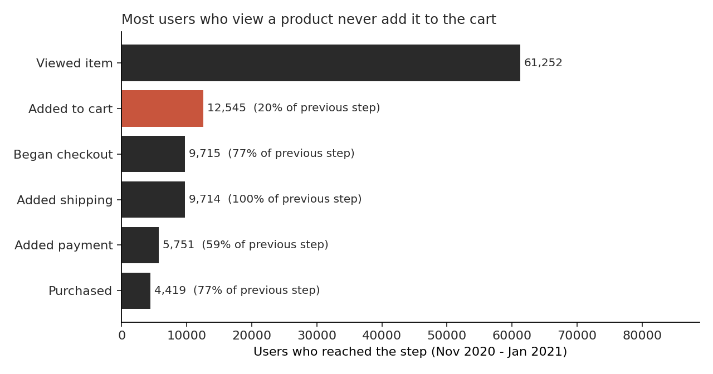

# GA4 E-commerce Funnel Analysis (BigQuery SQL)

An analysis of Google Analytics 4 event data from the Google Merchandise Store, using SQL in BigQuery and Python for charts and checks.

**Briefing note:** [reports/ga4_funnel_brief.md](reports/ga4_funnel_brief.md)



## Questions

1. Where in the purchase funnel do users leave?
2. Which traffic sources (organic search, direct, referral, paid search) bring users who buy?
3. Do mobile users convert differently from desktop users?
4. How did revenue change over the holiday season?
5. How reliable is the purchase and traffic-source data?

## Data

Google's public BigQuery dataset `bigquery-public-data.ga4_obfuscated_sample_ecommerce`: the GA4 export for the Google Merchandise Store, 1 Nov 2020 to 31 Jan 2021 (4,295,584 events, 270,154 users). Google obfuscated parts of the sample, so some values are hidden and it is not perfectly consistent.

## How it works

1. `sql/` holds the 5 queries. I ran them in the BigQuery console (free sandbox) and saved each result as JSON in `data/`.
2. `analysis.py` reads those files, works out conversion rates, and writes tables to `outputs/tables/`, charts to `outputs/figures/` and data quality counts to `outputs/data_quality.json`.
3. `tests/test_results.py` checks that the saved results agree with each other.

```bash
pip install pandas matplotlib
python analysis.py
python -m unittest discover tests   # 6 checks
```

Rerunning the SQL needs a Google Cloud project with BigQuery; the Python steps do not.

## Checks

The tests check that:

- purchase revenue adds up to the same total by month, by traffic source and by device;
- users and purchasers by traffic source add up to the store totals;
- each funnel step has no more users than the step before it;
- all rates are between 0 and 100.

The second check found a mistake in my first traffic-source query: a user's traffic source can change between events in this sample, so grouping events by source counted 328,574 users instead of 270,154. The query now assigns each user the source of their earliest event.

## Limitations

- The funnel counts users who did each step at least once; it does not require the steps in order or in one session.
- 15.9% of purchase events have no transaction ID, so the analysis counts purchasing users rather than orders.
- 18.5% of users have a hidden traffic source.
- The data covers the holiday season only.
